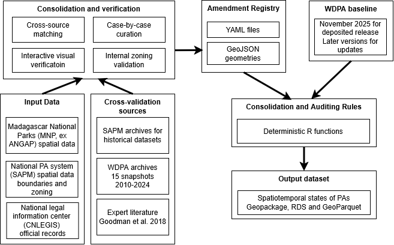
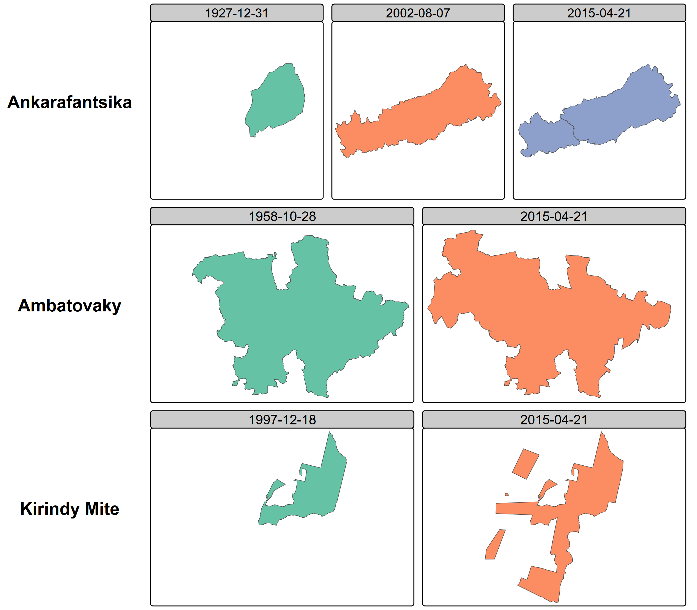
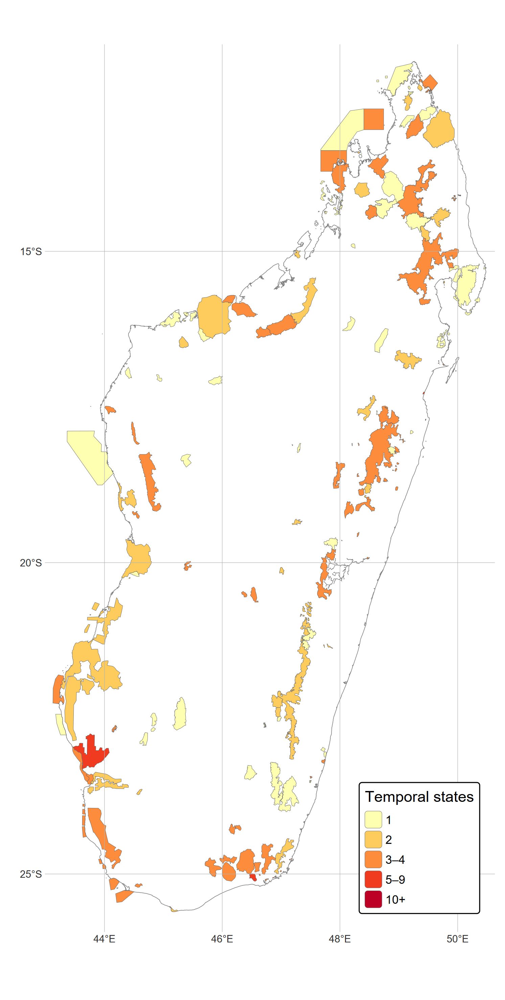
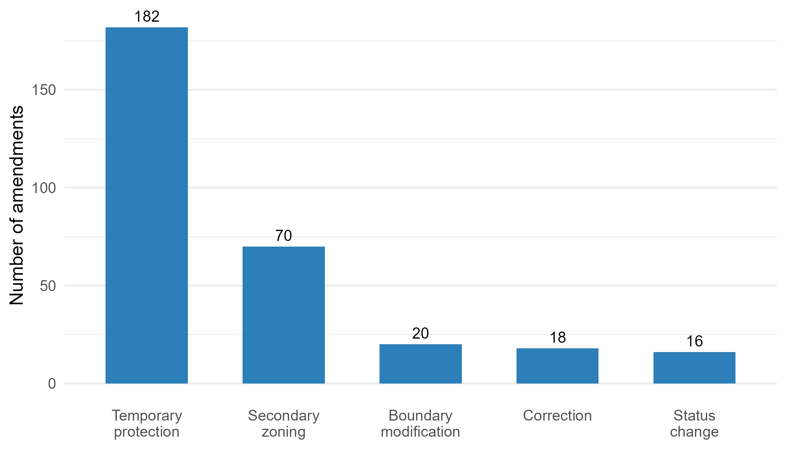

*Corresponding author: Florent Bédécarrats (florent.bedecarrats@ird.fr)*

# Background & Summary

Geospatial data on protected areas occupy a central place in research assessing conservation outcomes on the environment and human wellbeing. Whether studies assess the effect of protection on deforestation, measure the economic returns of ecotourism, or monitor progress toward international conservation targets, they depend on accurate spatial boundaries and status information. The World Database on Protected Areas (WDPA), maintained by the UN Environment Programme World Conservation Monitoring Centre, serves this role as the most comprehensive global inventory, documenting over 270,000 sites across more than 240 countries and territories [@bingham2019b]. Over the past two decades, the WDPA has become the default spatial reference for conservation planning, effectiveness assessments, and reporting against targets such as Aichi Biodiversity Target 11 and, more recently, the Kunming-Montreal Global Biodiversity Framework goal to protect 30% of the planet by 2030 [@Maxwell2020].

The WDPA, however, was designed as a snapshot database. It records the current state of each protected area, and when boundaries or designations change, the previous configuration is overwritten. The WDPA user manual itself warns against using the STATUS_YR field for historical analysis, and degazetted sites are simply removed from the database [@Bingham2019a]. This structural limitation has been recognized in the literature on protected area downgrading, downsizing, and degazettement (PADDD). Symes et al. [-@symesWhyWeLose2016] examined the factors driving PADDD events in the tropics and subtropics, showing that protected areas are not permanent — they can be reduced, reclassified, or revoked entirely. @lewisDynamicsGlobalProtectedarea2019 quantified the net area flux in the global protected area estate from 2004 to 2016 by comparing successive WDPA snapshots, finding that an average of 1.1 million km² was removed from the database annually across 223 countries and territories. Their analysis, however, could not distinguish on-the-ground changes from data-quality corrections, and the snapshot-comparison method itself erases the intermediate states it seeks to document.

What remains largely unaddressed is the continuous evolution of ongoing protected areas. Between creation and the present, many sites undergo boundary modifications, status reclassifications (for instance from Strict Nature Reserve to National Park), governance changes, internal zoning, or temporary protection decrees. None of these transformations are preserved in the WDPA's current-state model: each update silently replaces the previous configuration, making it impossible to reconstruct what a protected area looked like at any given date in the past.

A further dimension that static snapshot databases fail to capture is the internal zoning of protected   areas. In many national systems, multi-use protected area categories — typically corresponding to IUCN Categories III to VI — are internally subdivided into zones with distinct levels of permitted human activity. In Madagascar, the Protected Area Management Code (Code de Gestion des Aires Protégées, COAP; Law 2015-005) requires such sites to delineate a strictly protected core zone (noyau dur), where extractive uses are prohibited and biodiversity conservation takes legal precedence, alongside internal buffer zones where regulated resource use by surrounding communities may be permitted. The term “buffer zone” is used in the literature to refer both to areas surrounding core zones within protected areas and to areas surrounding the external boundary of protected areas [@Ebregt2000]. To avoid ambiguity, we distinguish throughout this manuscript and dataset between “internal buffer zones” and “external buffer zones.” The temporal emergence of these zones is a critical feature of conservation trajectories: a protected area’s external boundary is typically established by an initial creation decree, while its core zone may be delimited and formalized either in that same decree or in the site’s management and development plan, together with the other zoning categories, at a later stage. Impact evaluations relying solely on the external boundary may therefore misattribute outcomes to the protected area as a whole, whereas the effective protection signal on land use, biodiversity, and community access operates principally at the core zone level.

This matters for researchers from all disciplines that study conservation (biology, ecology, economics, anthropology, etc.). For instance, when impact evaluations assume that current boundaries have remained unchanged since a protected area was established, they may treat recently added areas as if they had been protected for much longer, inducing a downward biais in their results. It is also relevant for policymakers, as protected areas have become a major instrument of spatial planning, with global terrestrial coverage exceeding 17% in 2023 [@unep2024]. It also matters for conservation practitioners and local stakeholders, because shared spatial references support more transparent and equitable management.

Madagascar offers a particularly instructive demonstration case. The island is one of the world's foremost biodiversity hotspots, with forests sheltering over 80% of its biodiversity and endemism rates exceeding 80% across many taxonomic groups [@Waeber2020]. Its conservation history spans colonial-era strict nature reserves, post-independence national parks, and a rapid expansion following the 2003 Durban Vision, in which the government committed to tripling the protected surface to six million hectares [@Waeber2020]. This complex trajectory has been meticulously documented by Goodman et al. [-@Goodman2018] in a three-volume monograph covering 98 terrestrial sites, while the national protected area system (Système des Aires Protégées de Madagascar, SAPM) has produced successive spatial datasets, and the national legislative database (CNLEGIS) contains the legal decisions underpinning each status change. Yet no single dataset has assembled these complementary sources into a unified temporal record.

The problem, however, is not specific to Madagascar. In most countries, the WDPA contains protected areas whose histories of boundary and status changes are lost. The temporal data model we present here is designed to be generalizable to any country where complementary sources can supplement the WDPA baseline.

This paper presents three contributions. First, a temporal data model that extends the WDPA with time-bounded states, validity periods, legal source references, and secondary zoning, applicable to any national context. Second, a demonstration dataset covering 123 terrestrial protected areas in Madagascar from 2000 to 2025. Third, an open collaborative infrastructure consisting of a YAML amendment registry and a deterministic consolidation engine that enables other researchers to audit, correct, and extend the dataset through standard version control workflows. An interactive companion website allows visual exploration and verification of the data.


# Methods

The dataset was constructed through a multi-step pipeline integrating four complementary data sources, cross-referencing them through spatial and textual matching, curating amendments through expert review, and consolidating them into temporal states using deterministic rules. Access to institutional datasets and validation processes was facilitated through close collaboration with national authorities, ensuring consistency with official records and operational practices. 

The complete methodology is documented in a reproducible notebook accompanying this paper (see supplementary material). We summarize the key steps below and illustrate the overall workflow in @fig-workflow.

{#fig-workflow width=100%}

## Input data

Four categories of source material were assembled during the data reconstruction and validation process: spatial datasets produced or maintained by Malagasy institutions responsible for protected areas; current and historical versions of the World Database on Protected Areas; official legal records from the national legislative database and public gazette (Journal Officiel); and expert sources used to reconstruct or verify protected-area histories. These materials played different roles in the workflow: some were used only to identify or validate potential changes, whereas a more restricted set provides geometries or attribute amendments to the released dataset.

The current WDPA provides the baseline geometry and attributes to which documented historical amendments are applied. The consolidated release presented here uses the November 2025 WDPA for Madagascar. Historical WDPA snapshots were additionally examined during data preparation and validation. In one documented case, a historical geometry was reconstructed by separating polygons from the November 2025 WDPA geometry (labelled WDPA_2025_split in the metadata). WDPA-derived material is identified explicitly in the provenance metadata.

National spatial information comes from two institutional streams. First, "ANGAP_2002" is a historical spatial database of the Association Nationale pour la Gestion des Aires Protégées (ANGAP), which was renamed Madagascar National Parks (MNP) in 2008. Second, the sources "MNP_2010", "MNP_2010_split", "MNP_Anka_RNI_pre2002", and "MNP_Mantadia_pre2002" were produced or reconstructed by co-author Ollier D. Andrianambinina, Chef de Département Système d'Information et Innovation at MNP, in the combined context of his operational responsibilities at MNP and doctoral research on the use of spatial information for conservation research and management. These reconstructions draw on MNP spatial documentation and the legal descriptions of protected-area boundaries contained in official decrees and their annexes.

A second national stream consists of official spatial information produced or coordinated within the SAPM and the Ministry of Environment and Sustainable Development (MEDD). The geometries from this stream that enter the released dataset are identified as "SAPM_evol_2001-2011", "SAPM_2010" and "MEDD_subdivisions". Their provenance was verified within the institutional collaboration underlying this work, including by co-author Seheno Ramanantsoa, Chef du Service de la Gouvernance des Aires Protégées within the MEDD directorate responsible for protected areas and SAPM coordination.

Attribute amendments were derived from official legal instruments, principally decrees and ministerial or interministerial orders published through the Journal Officiel and made accessible through the Centre National de Légistique (CNLEGIS). Approximately 200 protected-area-related legal decisions were compiled and linked to WDPA identifiers using textual and spatial matching followed by manual verification. These legal records provide the authoritative basis for dates of creation, temporary protection, status changes, boundary modifications, and other dated amendments. WDPA attributes that are not explicitly amended are inherited from the baseline.

Additional sources, including the @Goodman2018 monograph and the associated Vahatra dataset, were used for historical interpretation, cross-checking and validation. Their geometries are not redistributed in the released dataset. Each geometry in the final files carries a "geometry_source_dataset_id" field, enabling to identify the source actually used from sources that were consulted only during curation.
Additional historical context was drawn from @Waeber2020.

## Consolidation and verification

Records from all four sources were matched to WDPA identifiers through a combination of spatial matching (centroid distance and polygon overlap ratios) and string-distance matching on protected area names. This step resolved name variants and multi-polygon entities.

A Shiny web application was developed and deployed for domain expert review. domain expert review. The validation involved protected area managers, GIS specialists from MEDD and Madagascar National Parks, and researchers with long-term experience on Madagascar’s protected area system. The application overlays geometries from different sources and time periods on interactive Leaflet maps, with filtering by IUCN category, dataset of origin, and associated legal texts. This tool enabled systematic visual comparison of boundaries reported by different sources for each protected area. The companion website provides ongoing access to this verification interface.

Core zone shapefiles from five organizations (MEDD, MNP, MBG, GERP, WWF) were collected and validated against WDPA external boundaries through spatial containment checks, yielding 73 validated core zone geometries that were integrated as secondary zones in the temporal dataset.

For approximately 25 protected areas with complex histories, a detailed case-by-case review was conducted, cross-referencing legal decisions, historical boundaries from Goodman et al. [-@Goodman2018], and successive SAPM datasets. @fig-examples illustrates three such cases. Amendments were documented in Spatial Amendment Tables (SAT) for geometries and Feature Attribute Tables (FAT) for attributes, then exported to the canonical YAML format.

{#fig-examples width=100%}

## YAML amendment registry

All corrections and temporal information are stored in a registry of YAML files, one per protected area, accompanied by GeoJSON geometry files where boundaries differ from the WDPA baseline. YAML was chosen because it is human-readable without specialized software, auditable in that each amendment includes the legal source, effective date, and amendment type, and Git-friendly in that text-based diffs enable collaborative editing with full change history tracking. Automated validation checks detect duplicate entries, temporal overlaps, and missing geometries.

The registry documents four types of amendments: boundary modifications (legally documented changes to external limits), status changes (reclassifications such as from Strict Nature Reserve to National Park), corrections (errors in the WDPA regarding dates, statuses, or geometries), and secondary zoning (internal zones including core zones and buffer zones).

## Consolidation and Auditing Rules

The final temporal states are generated by a deterministic consolidation engine implemented in R, referred to as the Consolidation and Auditing Rules (CAR). The engine reads the WDPA baseline and the YAML amendment registry, applies explicit precedence rules, and produces the output dataset. The process follows a delta-only model in which amendments override specific WDPA attributes or geometries for defined time intervals while all other attributes are inherited from the baseline. Three core functions implement the pipeline: `generate_timeline()` identifies temporal breakpoints from all amendments for a given WDPAID, `find_active_amendments()` determines which amendments are active at each time point, and `consolidate_pa_states()` merges baseline attributes with active amendments to produce each temporal state. Because the rules are coded explicitly and the inputs are versioned, the entire transformation is reproducible and auditable.


# Data Records
The dataset is publicly deposited in DataSuds under the persistent identifier https://doi.org/10.23708/VN2TWC, for Bedecarrats, Florent, Ramanantsoa, Seheno, Andrianambinina, Ollier D. , 2026, "Dynamic spatial conservation boundaries and internal zoning of Madagascar from 2000 to 2025", DataSuds. Version 2.0 contains three equivalent consolidated representations of the temporal dataset, `dynamic_wdpa.gpkg`, `dynamic_wdpa.rds`, `dynamic_wdpa.parquet`, and  together with `amendments.zip`, which contains a snapshot of the version-controlled YAML amendment registry and associated GeoJSON geometries. The three consolidated files contain the same information in distinct formats suited respectively to GIS software, R, and a broader range of data analysis solutions.

The consolidated files are based on the November 2025 WDPA release and should therefore be regarded as a historical research snapshot rather than as the current official protected-area database. Users requiring the latest official protected and conserved area information should obtain it directly from Protected Planet. UNEP-WCMC has provided written authorization for redistribution of the Madagascar-specific WDPA-derived outputs included in this dataset. Commercial use remains subject to the WDPCA Data License, which prohibits commercial use of WDPCA materials and derivative works without prior written permission from UNEP-WCMC [@unepwcmcWDPCAlicense].

Provenance is retained at row level. The field `amendment_source` records whether a row is inherited directly from the WDPA baseline, generated from a documented amendment, or reconstructed from amendment information where no current WDPA record exists. The field `geometry_source_dataset_id` records the spatial dataset from which the geometry itself originates. This enables users to trace each geometry in the released files back to the institutional or WDPA source actually used in the reconstruction.

Each row in the output dataset represents one zone in one temporal state. A protected area with boundary changes and internal zoning will have multiple rows across time periods. @tbl-schema describes the fields.

| Field | Type | Description |
|---|---|---|
| `state_id` | Character | Unique identifier for each temporal state |
| `WDPAID` | Integer | WDPA identifier, enabling cross-reference with the global database |
| `valid_from` | Date | Start date of this state's validity period |
| `valid_to` | Date | End date of this state's validity period |
| `zone_type` | Character | Zone type: `external_boundary`, `core_zone`, `internal_buffer_zone`, or `external_buffer_zone` |
| `zone_name` | Character | Name of the zone, if applicable |
| `geometry` | Geometry | Polygon or multipolygon in WGS84 (EPSG:4326) |
| `NAME` | Character | Protected area name |
| `DESIG` | Character | Designation type |
| `IUCN_CAT` | Character | IUCN management category |
| `STATUS` | Character | Designation status |
| `STATUS_YR` | Integer | Year of current status |
| `GOV_TYPE` | Character | Governance type |
| `MANG_AUTH` | Character | Management authority |
| `amendment_source` | Character | Reference to the YAML amendment file or `"wdpa_baseline"` |

: Schema of the temporal states dataset. {#tbl-schema}

The dataset covers 123 terrestrial protected areas in Madagascar with a temporal span from 2000 to 2025. Protected areas have between one and several temporal states depending on the documented amendments. Secondary zones are included for 73 protected areas where validated core zone shapefiles were available. @fig-map shows the spatial distribution of protected areas colored by the number of documented temporal states, illustrating where the dataset adds information relative to the static WDPA.

{#fig-map width=70%}

The data model and the associated infrastructure are designed to be generalizable to any country or region where complementary sources can supplement the WDPA baseline, and extensible to the full diversity of protected area modifications including boundary changes, status reclassifications, governance changes, temporary protections, and any form of internal zoning.


# Technical Validation

Spatial overlap between the WDPA, successive SAPM versions, and the Vahatra dataset was quantified using mutual inclusion ratios. For each protected area present in multiple sources, the proportion of area shared between paired geometries was computed, flagging cases with less than 80% overlap for manual review. Date and status discrepancies between sources were systematically catalogued and resolved through legal text verification.

Every amendment in the YAML registry is linked to a specific legal decision identified by its decree or order number, date, and URL in the CNLEGIS database. Domain experts reviewed all amendments through the interactive Shiny dashboard, verifying that recorded boundary changes and status modifications match the corresponding legal texts.

Automated checks enforce three invariants across the dataset: no overlapping validity periods exist for the same zone of the same protected area; no temporal gaps exist in the coverage of external boundaries from the creation date to the reference date; and `valid_from` is strictly earlier than `valid_to` for every state.

All geometries were validated using `sf::st_make_valid()` in R. Core zones were verified to fall within their parent protected area's external boundaries using spatial containment checks. Coordinate reference system consistency was enforced across all source datasets.

@fig-amendments summarizes the types and counts of amendments documented in the registry. 

{#fig-amendments width=70%}


# Usage Notes

The published dataset can be used directly without reproducing the data-preparation pipeline. The GeoPackage can be opened in standard GIS software including QGIS and ArcGIS and in R or Python through geospatial libraries. The Parquet representation is intended for efficient analytical workflows, while the RDS file preserves the R spatial object directly. The `WDPAID` field enables linkage with other WDPCA-based datasets.

Temporal configurations can be selected using `valid_from` and `valid_to`. Validity intervals follow a start-inclusive and end-exclusive convention. An `NA` value in `valid_to` indicates that no later state is recorded and therefore normally identifies the configuration valid at the reference date. The `zone_type`field distinguishes external protected-area boundaries from secondary zoning geometries.
Researchers wishing to update the dataset beyond the November 2025 baseline can download a more recent WDPCA release from Protected Planet and apply the published amendment registry using the Consolidation and Auditing Rules provided in the GitHub repository. This reconstruction route uses the curated YAML and GeoJSON amendment registry as input and does not require repeating the complete historical source-curation process.

Users must observe the reuse conditions associated with the underlying source data. In particular, commercial use of WDPCA material or works derived from it requires prior written permission from UNEP-WCMC [@unepwcmcWDPCAlicense]. UNEP-WCMC has separately provided written authorization for public redistribution of the Madagascar-specific derived outputs included in this dataset for the non-commercial use case described here.

The YAML amendment registry is designed for collaborative extension. Researchers who identify additional legal texts, historical maps, or field-validated boundaries can propose corrections or new amendments through the associated GitHub repository, where changes remain auditable through version control. The interactive companion application allows users to explore individual protected areas and compare boundaries from different sources.


# Data Availability Statement

The complete research dataset is publicly available from DataSuds, the institutional research data repository of the Institut de Recherche pour le Développment, at https://doi.org/10.23708/VN2TWC [@bedecarrats2026dataset]. Version 2.0 includes the consolidated files `dynamic_wdpa.gpkg`, `dynamic_wdpa.parquet`, and `dynamic_wdpa.rds`, together with the archived amendment registry `amendments.zip`. The version-controlled amendment registry and associated processing code are also maintained in the GitHub repository at https://github.com/BETSAKA/conservation-dynamic-madagascar.

The consolidated files incorporate information derived from the November 2025 WDPCA release. UNEP-WCMC has provided written authorization for redistribution of these Madagascar-specific derived outputs for this non-commercial use case. Commercial use of WDPCA material or derivative works requires prior written permission from UNEP-WCMC [@unepwcmcWDPCAlicense]. The deposited files constitute a historical research snapshot; users requiring the latest official protected and conserved area data should obtain the current release directly from Protected Planet.

Geometry-level provenance is recorded in `geometry_source_dataset_id`, while amendment-level provenance and corresponding legal sources are documented in the YAML registry. Source datasets that are not themselves redistributed can therefore be identified from the published metadata.

# Code Availability

All source code is available at https://github.com/BETSAKA/conservation-dynamic-madagascar under the MIT License. The repository contains the Quarto documentation, interactive verification application, amendment registry, and CAR consolidation engine. Data files contained in or linked from the repository remain subject to the source-specific reuse conditions described in the Data Availability Statement.


# Acknowledgements

This work was conducted within the BETSAKA project, supported by KfW (grant BMZ 2018-68-538/KfW 108778), Agence Française de Développement (grant PAIRES-CZZ2557), Institut de Recherche pour le Développement (IRD) and Agence Nationale de la Recherche (grant ANR-22-CPJ1-0052-01). The project is coordinated by IRD/UMI-SOURCE and the Université d'Antananarivo/CERED. We thank the Vahatra Association for the foundational monograph on Madagascar's protected areas, the CNLEGIS team for maintaining the national legislative database, and the organizations (MEDD, MNP, MBG, GERP, WWF) that shared core zone spatial data.

# Funding

This work was supported by KfW (grant number BMZ 2018-68-538 / KfW 108778), Agence Française de Développement (grant number PAIRES-CZZ2557), and Agence Nationale de la Recherche (grant number ANR-22-CPJ1-0052-01).


# Author Contributions

Following the CRediT (Contributor Roles Taxonomy) framework: F.B.: Conceptualization, Methodology, Software, Formal analysis, Data curation, Writing – original draft, Visualization, Project administration. S.R.: Investigation, Data curation, Validation, Resources, Writing – review & editing. O.D.A.: Investigation, Data curation, Validation, Resources, Writing – review & editing.


# Competing Interests

S.R. is a civil servant in charge of protected area governance at the Ministère de l'Environnement et du Développement Durable (MEDD) of Madagascar. O.D.A. heads the data information system and innovation unit at Madagascar National Parks (MNP). Producing and maintaining protected area information is part of their professional responsibilities. The authors have no financial conflicts of interest to declare.


# Funding

BETSAKA project, supported by KfW, Agence Française de Développement (AFD), Institut de Recherche pour le Développement (IRD), and Agence Nationale de la Recherche (ANR).


# References

```{=typst}
#set bibliography(title: none)
```

::: {#refs}
:::
